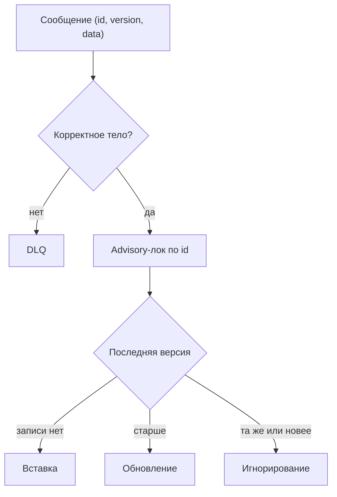

# Шаблон сервиса

`isp-service-template` — базовый шаблон микросервиса экосистемы isp на `isp-kit`.
Шаблон демонстрирует типовые сценарии: получение объекта из PostgreSQL и приём
сообщений из очереди RabbitMQ. Шаблон готов к использованию как стартовая точка нового
сервиса: в нём уже есть конфигурация, логирование, наблюдаемость, hot-reload удалённой
конфигурации и миграции БД.

## Получение объекта

Демонстрационная модель — объект с идентификатором и именем. Сервис возвращает список
всех объектов в порядке возрастания идентификатора либо отдельный объект по
идентификатору. Если объект не найден, возвращается ошибка с кодом `800`.

## Приём сообщения

Консьюмер принимает сообщения из очереди: сообщение содержит идентификатор (`id`),
версию (`version`) и данные (`data`). Обработка происходит внутри транзакции:

1. Тело сообщения разворачивается; некорректное тело отправляется в DLQ.
2. По идентификатору сообщения берётся advisory-лок.
3. Последняя сохранённая версия сравнивается с версией из сообщения.

Новое сообщение вставляется, более новая версия обновляет запись, повтор той же
или более старой версии игнорируется.

## Коды ошибок

- `800` — объект не найден

Коды фреймворка: `400` — ошибка валидации тела запроса, `900` — внутренняя ошибка сервиса.
